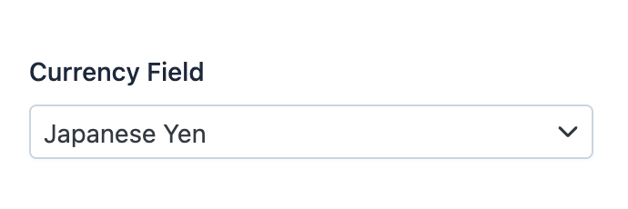

EasyAdmin Currency Field
========================

This field is used to represent a value that stores the `3-letter ISO 4217`_ code
of some currency.

To express that no currency is involved, use the ``CurrencyField::CURRENCY_NONE``
constant, which holds the ISO 4217 ``'XXX'`` code. That code has no name or
symbol of its own, so EasyAdmin displays the generic currency sign ``¤`` for it.
The ``setCurrency()`` method of the :doc:`MoneyField </fields/MoneyField>`
accepts this constant too.

In :ref:`form pages (edit and new) <crud-pages>` it looks like this:

Basic Information
-----------------

* **PHP Class**: ``EasyCorp\Bundle\EasyAdminBundle\Field\CurrencyField``
* **Doctrine DBAL Type** used to store this value: ``string``
* **Symfony Form Type** used to render the field: `CurrencyType`_
* **Rendered as**:

  .. code-block:: html

    <select> ... </select>

Options
-------

``setBadgeVariant``
~~~~~~~~~~~~~~~~~~~

When you use the ``showCode`` or ``showSymbol`` options, the currency code and
symbol are displayed as badges. Use this option to change the visual style of
those badges.

By default, it uses the badge variant configured with the ``setBadgeVariant()``
method of the :ref:`CRUD design options <crud-design-options>` (``light`` if
you don't configure it). The other values are ``solid``, ``outline`` and ``dot``.

This option only changes the badges of this field, not the badges of other
fields::

    yield CurrencyField::new('...')->setBadgeVariant('dot');

``showCode``
~~~~~~~~~~~~

By default, this field displays the name and the symbol of the currency, but not
its ISO 4217 code. For example, for the currency of Japan it displays "Japanese Yen"
(the name) and ``¥`` (the symbol) but not ``JPY`` (the code).

Use this option to display the currency code::

    yield CurrencyField::new('...')->showCode();

``showName``
~~~~~~~~~~~~

By default, this field displays the name of the currency (``Mexican Peso``,
``Indian Rupee``, etc.). If you prefer to not display the name (and only display
the symbol and/or code of the currency) set this option to ``false``::

    yield CurrencyField::new('...')->showName(false);

``showSymbol``
~~~~~~~~~~~~~~

By default, this field displays the symbol of the currency (``€``, ``$``, ``£``,
etc.). If you prefer to not display the symbol (and only display the name and/or
code of the currency) set this option to ``false``::

    yield CurrencyField::new('...')->showSymbol(false);

.. _`3-letter ISO 4217`: https://en.wikipedia.org/wiki/ISO_4217
.. _`CurrencyType`: https://symfony.com/doc/current/reference/forms/types/currency.html
